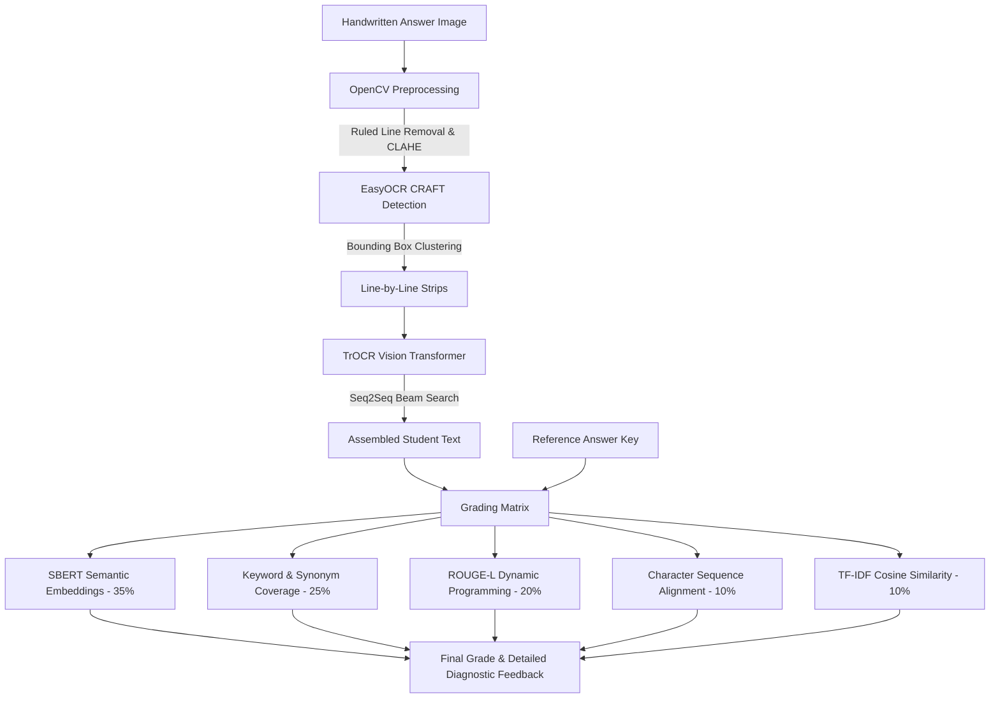

# 📝 Handwriting Recognition & Automated Grading System

An end-to-end AI-powered document intelligence and automated grading platform. This project integrates a **hybrid dual-engine OCR pipeline** (combining CRAFT spatial detection with Vision-Transformer sequence recognition) with a **multi-dimensional NLP grading matrix** to transcribe handwritten answers from ruled or unruled paper and automatically evaluate them against reference answer keys.

---

## 🚀 Key Features

* **Hybrid OCR Architecture:**
  * **Line Detection & Spatial Grouping:** Uses EasyOCR (CRAFT detector) to detect handwritten word regions, group bounding boxes by vertical coordinate proximity, and slice individual text lines.
  * **Ruled-Line Noise Filtering:** Built-in OpenCV preprocessing using morphological opening and Hough Transform line subtraction to strip notebook lines without clipping character ascenders/descenders.
  * **Cursive Handwriting Recognition:** Uses Microsoft's [`microsoft/trocr-base-handwritten`](https://huggingface.co/microsoft/trocr-base-handwritten) Vision Transformer (ViT) encoder-decoder for single-line cursive text transcription.
  * **Dual Engine Mode:** Runs both EasyOCR and TrOCR side-by-side to allow visual comparison of transcription fidelity.

* **5-Dimensional Automated Grading Engine:**
  Evaluates student answers against reference keys across five weighted NLP dimensions:
  1. **Semantic Similarity (35%):** Dense contextual vector embeddings via Sentence-BERT (`all-MiniLM-L6-v2`).
  2. **Keyword Coverage (25%):** Extracts critical answer-key terms, supporting synonym group mapping and fuzzy Levenshtein matching for OCR tolerance ($\ge 80\%$).
  3. **N-gram / ROUGE-L Overlap (20%):** Word-level Longest Common Subsequence (LCS) computed via Dynamic Programming.
  4. **Character Sequence Match (10%):** Ratcliff-Obershelp gestalt pattern matching.
  5. **TF-IDF Cosine Similarity (10%):** Term-frequency importance weighting.
  * *Adaptive Re-weighting:* Automatically reallocates weights if running in a lightweight environment without SBERT.

* **Interactive Web Dashboard:**
  * Responsive Flask frontend with drag-and-drop file upload, side-by-side OCR result inspector, score dials, dimension radar/bar breakdown, and letter grade issuance (A+ through F).

---

## 🏗️ System Architecture



---

## 📁 Repository Structure

```
.
├── src/
│   ├── inference.py                # Dual OCR engine (EasyOCR + TrOCR hybrid)
│   ├── evaluate_model.py           # Model benchmark script (CER / WER calculation)
│   ├── benchmark_timing.py         # End-to-end latency & processing time profiler
│   ├── noise_reduction_analysis.py # OpenCV morphological filter validation
│   ├── finetune_trocr.py           # Line-level Seq2Seq TrOCR training pipeline
│   └── finetune_trocr_kaggle.py    # Word-level IAM dataset fine-tuning script
├── templates/
│   └── index.html                  # Web UI dashboard
├── data/
│   └── reference_answers/
│       └── answers.txt             # Preloaded question/answer rubrics
├── web_app.py                      # Flask backend and grading coordinator
├── requirements.txt                # Python package dependencies
├── .gitignore                      # Exclusion rules for models, datasets, & cache
└── README.md                       # Documentation
```

---

## 🛠️ Installation & Setup

### Prerequisites
* Python 3.10+
* CUDA-compatible GPU (recommended for TrOCR inference latency $< 1.2\text{s}$, though CPU execution is fully supported)

### 1. Clone the Repository
```bash
git clone https://github.com/SuryaPranav2k5/OCR.git
cd OCR
```

### 2. Create and Activate a Virtual Environment
```bash
# Windows
python -m venv venv
.\venv\Scripts\activate

# Linux / macOS
python3 -m venv venv
source venv/bin/activate
```

### 3. Install Dependencies
```bash
pip install --upgrade pip
pip install -r requirements.txt
```

---

## 💻 Usage

### Running the Web Application
Start the Flask development server:
```bash
python web_app.py
```
Open your browser and navigate to:
```
http://localhost:5001
```

1. **Upload:** Drag and drop an image containing handwritten text (JPEG, PNG).
2. **Transcribe:** View transcription outputs generated by EasyOCR and TrOCR.
3. **Grade:** Select or enter a reference answer key and maximum score, then submit to receive an itemized grade report with letter grade, percentage, and dimensional scoring metrics.

---

## 🔬 Benchmark & Analysis Scripts

Run any of the evaluation tools located in `src/`:

```bash
# 1. Measure pipeline latency across iterations
python src/benchmark_timing.py

# 2. Evaluate Character Error Rate (CER) and Word Error Rate (WER)
python src/evaluate_model.py

# 3. Analyze ruled paper noise reduction and PSNR metrics
python src/noise_reduction_analysis.py
```

---

## 📜 License

This project is licensed under the Apache 2.0 License.
